# OT — unificação comercial premium (candidata)
Data da missão: 16/11/2026, horário de São Paulo.
Base de produção e comparação: `2d6873bffbc66aafd1ff153a0455546b507a9759`.
**NO-GO para merge, produção e mídia paga até concluir a homologação.**

## Evidência e limites
A execução local não estava disponível. A implementação foi preparada pelo GitHub e testada em runners do CI. Capturas novas e PNGs foram devolvidos pelo próprio CI; foram inspecionadas as dez comparações de primeira dobra (cinco páginas em desktop/mobile), as cinco capas OG e as cinco prévias de Stories. Nenhuma captura antiga ou imagem gerada foi apresentada como evidência de navegação.

Execução funcional verificada: [CI 43982501580](https://github.com/olegariotech-site/olegariotech-site/actions/runs/43982501580), commit `10bc805c4792f218b1c6c2f861ea4ddd9a2102ab`. A matriz comercial passou **40 viewports por motor, 80 no total**, com axe nas cinco páginas mobile, diagnóstico completo, origem/UTMs, reinício, teclado e consentimentos separados. SEO local existente também passou em Chromium e WebKit. JSON numérico: [QA-10bc805.json](QA-10bc805.json).

As capturas abaixo foram atualizadas para o commit 7acb792fa72ef697f2d7ca5ffcb041a82f0a4416, já com a correção de privacidade e estabilidade de fontes. O workflow repete capturas na revisão final; o status do último HEAD e os links dos artefatos ficam no PR. A inspeção da primeira dobra não certifica todas as interações de aparelhos físicos nem conformidade integral de acessibilidade.

O Gate B permanece bloqueado: `verify-premium-v3.mjs` exige igualdade histórica do HTML das landing pages. Não foi alterado, relaxado ou desligado. Esse contrato precisa de revisão própria compatível com o escopo autorizado; não liberar merge contornando-o.

## Direção visual e prioridades
O ponto de partida é a home e o DESIGN.md já aprovado: fundo #050008, Space Grotesk, Inter, Share Tech Mono, ciano #67e8f9 e violeta #8b5cf6. As páginas de serviço já usam esses fundamentos; não precisam de outra marca nem de um novo motor 3D.

| Prioridade | Evidência do código da base | Proposta implementada para revisão |
|---|---|---|
| P1 | Títulos das páginas locais chegam a 5.7rem; HERO mínimo de 650px; anúncios têm ajustes locais próprios | Escala e espaçamento comuns, com CTA antes da imagem; atmosfera estática reaproveitada |
| P1 | No mobile, a navegação comercial esconde links e deixa só o diagnóstico | Cabeçalho comum, menu nativo details/summary com cinco serviços e Início, Escape e foco |
| P1 | CTA principal genérico para diagnóstico em todos os serviços | WhatsApp principal específico por serviço; diagnóstico secundário com origem conhecida |
| P1 | Diagnóstico usa cabeçalho próprio; footer oculto em desktop; input só com placeholder | Identidade comum, footer visível, label explícito, botão de começar antes do painel |
| P1 | Links diretos de WhatsApp já têm mensagens por página; diagnóstico perde o serviço anterior | Preservar mensagens, propagar UTMs com limites e origem allowlisted; acrescentar só nome público da página à mensagem |
| P2 | Casos reais já presentes nas páginas locais; anúncios não têm prova de infraestrutura | Preservar cases e adicionar nos anúncios dois sites reais, explicitamente sem resultados de mídia paga |
| P2 | Depoimentos reais já publicados na home | Reutilizar literalmente Lucas Mazett e Cíntia Pereira Almeida Gomes, com o mesmo link de avaliações gerais |
| P2 | Processo técnico existe, mas a sequência comercial não é uniforme | Quatro passos de contratação, sem inventar preço ou prazo |
| P2 | Quatro serviços usam a mesma capa OG genérica | Cinco capas específicas e cinco Stories em fontes SVG, com roteiro e exportação PNG auditáveis |

## Antes/depois proposto por página
1. **Home de referência:** somente leitura; HTML, assets e comportamento preservados. Saúde: referência preservada; nenhuma alteração de código.
2. **Sites Valinhos:** H1, conteúdo local, casos Armazém/Açaí e SEO preservados. Novo cabeçalho, ritmo, CTA de site, depoimento e contratação. Saúde: primeira dobra conferida; QA funcional verde.
3. **Sites Campinas:** conteúdo próprio de serviços/logística e casos K.L/Cíntia preservados. Mesmos componentes, sem homogeneizar os textos das cidades. Saúde: primeira dobra conferida; QA funcional verde.
4. **Google/SEO:** preservar case K.L em destaque, dois complementares e diferenças entre Perfil da Empresa e SEO. CTA específico e identidade comum. Saúde: primeira dobra conferida; QA funcional verde.
5. **Anúncios:** preservar mockups rotulados como ilustrativos, regras de verba/gestão e ausência de garantia. Cases adicionais comprovam sites, não campanhas. Saúde: primeira dobra conferida; QA funcional verde.
6. **Diagnóstico:** manter cinco perguntas, resultado e mensagem com respostas. Acrescentar label, origem pública e identidade; scroll respeita movimento reduzido. Saúde: primeira dobra e jornada conferidas; Issue #126 permanece aberta.

## Marca e ativos
- Logo fonte: `assets/img/brand/olegario-tech-logo-oficial.webp`, SHA `679f87403eb8cdaa16b8ae0364e61551093a7727`.
- O arquivo original tem grandes margens pretas. `ot-logo-commercial.svg` é um invólucro com viewBox que enquadra a imagem original embutida. Não redesenha curvas nem interpreta o símbolo.
- Terra: `assets/img/orbit/ot-earth-atmosphere-static-v2.webp`, SHA `cdb61cc52d8fbcb2af75962ce552fa62aa827f71`. Mantida como imagem, sem WebGL/Three no runtime comercial.
- `ot-commercial-premium.css` só é carregado pelas cinco páginas e usa opt-in `body.ot-commercial`. A home não carrega esse arquivo.
- As fontes do kit são SVGs autossuficientes para os rasters embutidos; usam as famílias oficiais quando disponíveis. O exportador carrega e verifica fontes antes de gerar PNG.

## SEO, origem e métricas
Titles, descriptions, canonical, H1, conteúdo local, schemas existentes, robots.txt e sitemap.xml são preservados. O diagnóstico ganha WebPage e BreadcrumbList. Não foram criadas novas páginas comerciais.
O atributo origem identifica somente um dos cinco serviços públicos. O helper não cria cookies, storage nem eventos. Encaminha UTMs em links internos apenas se forem slugs curtos e seguros; não coloca UTMs na mensagem de WhatsApp. Nomes de empresas e respostas continuam no fluxo existente e não são enviados por um novo evento.
O JS de diagnóstico só altera a opção de scroll sob prefers-reduced-motion. Os demais comportamentos de medição seguem a base.

**Issue #126 permanece um gate de mensuração:** generate_lead ainda pode acompanhar o clique. Isso não comprova conversa recebida. Não usar os eventos atuais como volume de leads confirmados, nem otimizar campanha por esse indicador até a revisão específica. Este PR não muda GA4, Pixel, consentimento, eventos-chave ou dados históricos. Nenhum teste emite requisições para coletores de produção.

## Kit de divulgação
`kit.json` contém links oficiais, legenda curta e CTA por página. `kit/` contém dez fontes SVG (1200×630 e 1080×1920), reaproveitando os bytes dos ativos da marca.
Executar `node scripts/render-commercial-kit.mjs` com Playwright disponível. A exportação gera dez PNGs e manifesto no artefato `ot-commercial-premium-chromium/kit`.

**Capas OG integradas na candidata:** os cinco PNGs inspecionados estão em `assets/img/commercial/`; og:image e twitter:image de cada página apontam para o respectivo arquivo, com 1200×630 e MIME PNG. Testes validam presença e dimensões; crawler real do WhatsApp/Meta e URLs públicas só podem mostrar a nova versão depois de publicação autorizada.
Stories devem ser revisados também com a interface real das plataformas; o SVG reserva a composição principal entre 250 e 1670px.

## QA e evidências esperadas
Workflow adicional: `OT commercial premium candidate QA`, Chromium + WebKit. Os workflows e gates existentes permanecem intactos.
- Comparação byte a byte de home, teste protegido do PR #125, analytics, consentimento, robots e sitemap.
- Oito viewports: 1920×1080, 1440×900, 1366×768, 1024×768, 768×1024, 360×780, 390×844, 430×932.
- Capturas atuais antes/depois em 1440px e 390px; depois nos demais tamanhos. Conferir arquivos antes de aceitar como prova.
- HTTP, ausência de 404/erros JS/overflow, H1/canonical, imagens, targets de 44px, primeira dobra, menu, teclado, axe.
- Jornada UTM → serviço → diagnóstico → cinco respostas → resultado → link WhatsApp interceptado → reinício.
- Três amostras frias alternadas antes/depois, para cinco páginas em desktop/mobile Chromium, com LCP, CLS, bytes locais e DOM. A primeira medição forçava lazy images para screenshot; a revisão seguinte mede o carregamento natural e atribui deslocamentos aos elementos. São medições de laboratório sem emulação de rede/CPU; não são Core Web Vitals de usuários reais nem INP.
- A matriz WebKit cobre o motor; não certifica aparelho iPhone, Edge/Android físico ou UI de Safari.

## Critérios para GO
1. CI atual verde, incluindo gates existentes sem ajustes de tolerância ou desligamento.
2. Revisão humana das capturas e dos PNGs, correção dos problemas encontrados.
3. Ler comparação de performance; investigar regressões de LCP/CLS e requests antes de liberar.
4. Integrar PNGs OG e validar compartilhamento; manter fontes e legenda correspondentes.
5. Confirmar consentimento negado/concedido e DebugView controlado sem contaminar operação; resolver semântica da Issue #126 em trabalho separado autorizado.
6. Autorização explícita da direção OT para merge e publicação. Aprovação da branch não é autorização de campanha ou gasto.

## Governança
PR #125 não foi alterado: sem commits na branch dele, sem modificação em index.html ou scripts/verify-premium-v3.mjs.
Não houve merge, deploy, envio de mensagens, compra, contratação nem ativação de campanha.

## Parecer de performance registrado
No commit 10bc805, as medianas LCP de laboratório ficaram entre 140 e 256ms na candidata. Esses números refletem servidor local e não devem virar promessa comercial. Uma amostra de Campinas desktop teve CLS 0,12537; por isso não foi declarado desempenho preservado e a revisão final repete a medição com atribuição. Anúncios ganhou imagens de cases lazy; os bytes totais forçados cresceram de aproximadamente 103KB para 360KB, não equivalendo ao payload inicial natural. O último resumo numérico está no PR.

## Evidências antes/depois inspecionadas
Esquerda: base de produção; direita: candidata 7acb792. O botão de privacidade continua nativo, com o nome acessível preservado; no mobile, a engrenagem tem alvo de 44px e foi testada com abertura real do painel.

### criacao-de-sites-valinhos

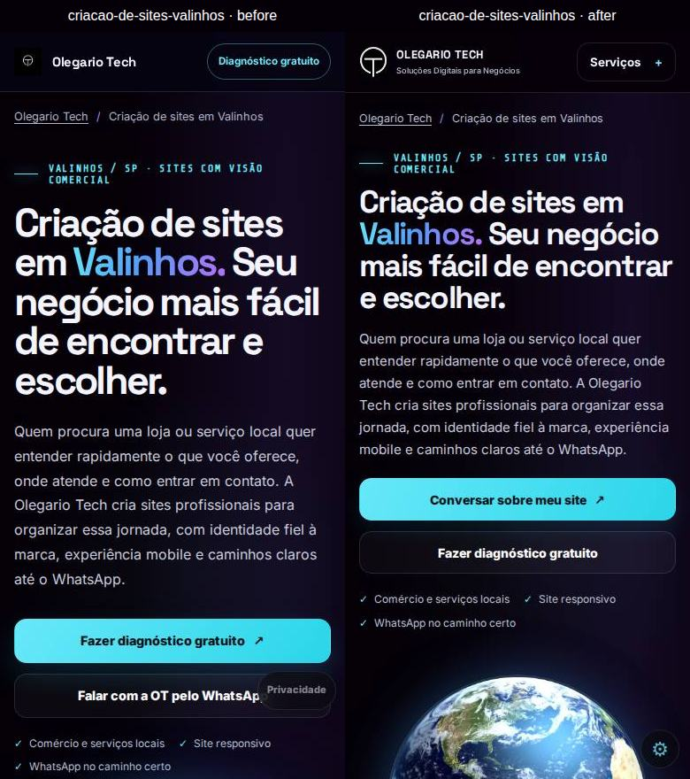

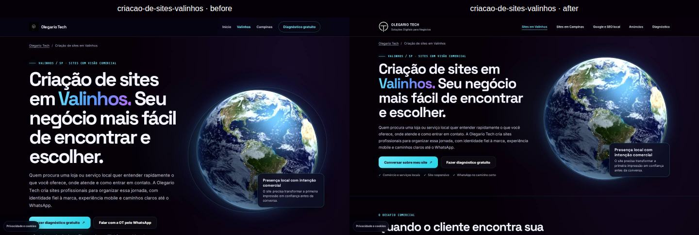

[Prévia Story](evidence/criacao-de-sites-valinhos-story-preview.jpg) · [Fonte OG](kit/criacao-de-sites-valinhos-og.svg) · [Fonte Story](kit/criacao-de-sites-valinhos-story.svg)

### criacao-de-sites-campinas

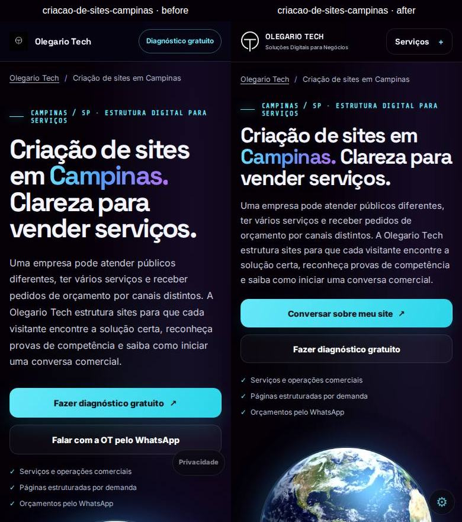

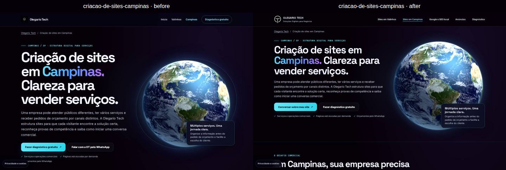

[Prévia Story](evidence/criacao-de-sites-campinas-story-preview.jpg) · [Fonte OG](kit/criacao-de-sites-campinas-og.svg) · [Fonte Story](kit/criacao-de-sites-campinas-story.svg)

### presenca-no-google

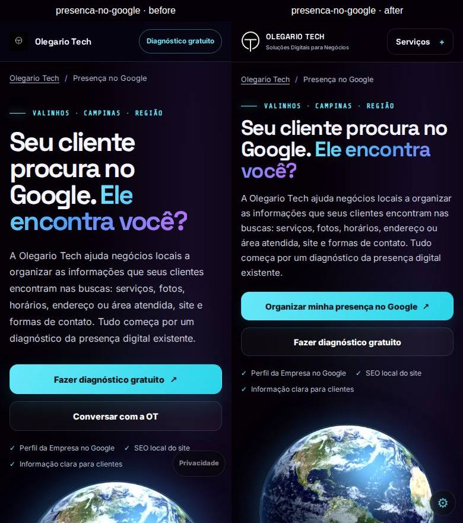

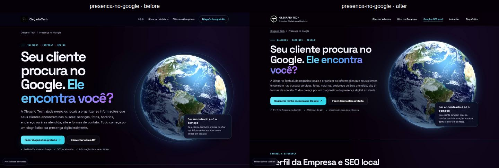

[Prévia Story](evidence/presenca-no-google-story-preview.jpg) · [Fonte OG](kit/presenca-no-google-og.svg) · [Fonte Story](kit/presenca-no-google-story.svg)

### anuncios-google-instagram

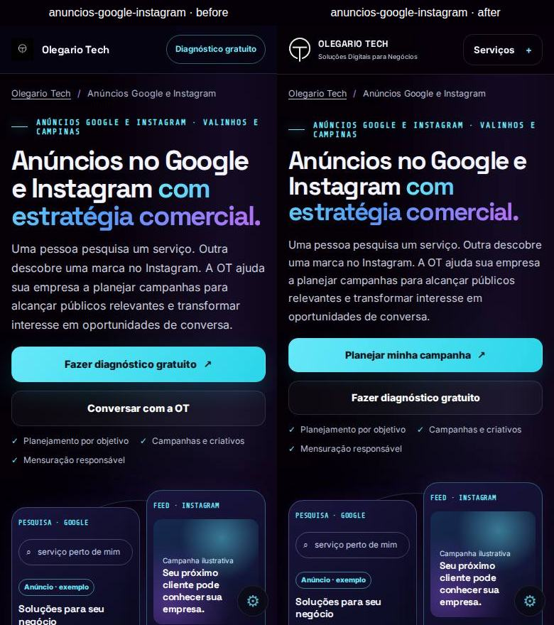

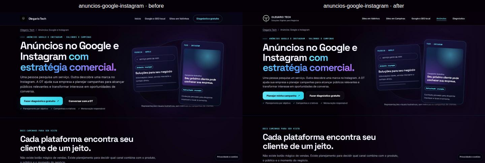

[Prévia Story](evidence/anuncios-google-instagram-story-preview.jpg) · [Fonte OG](kit/anuncios-google-instagram-og.svg) · [Fonte Story](kit/anuncios-google-instagram-story.svg)

### diagnostico-digital

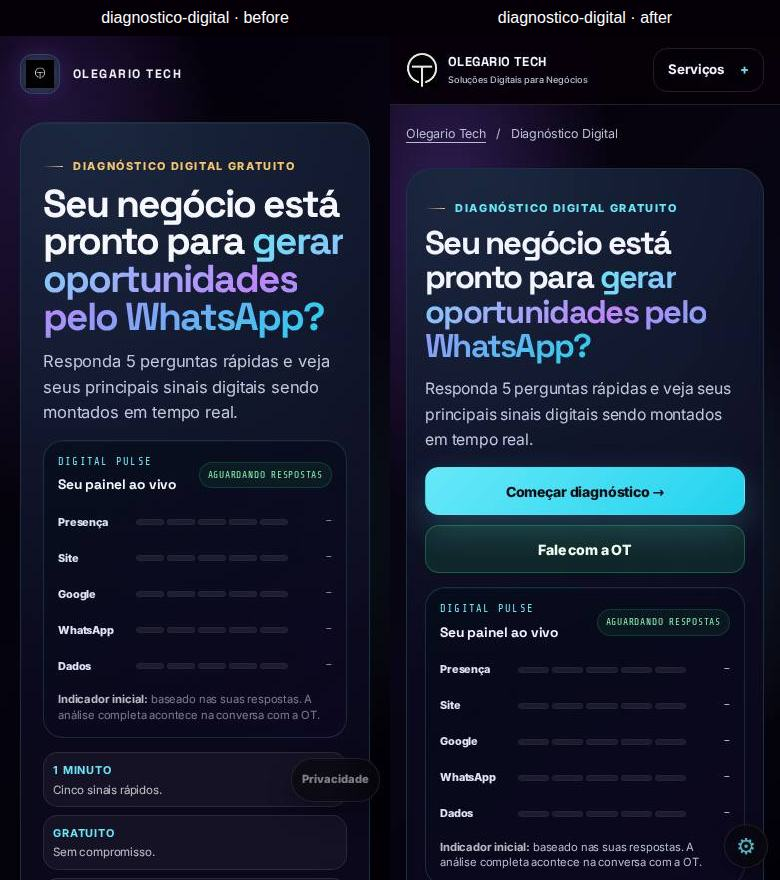

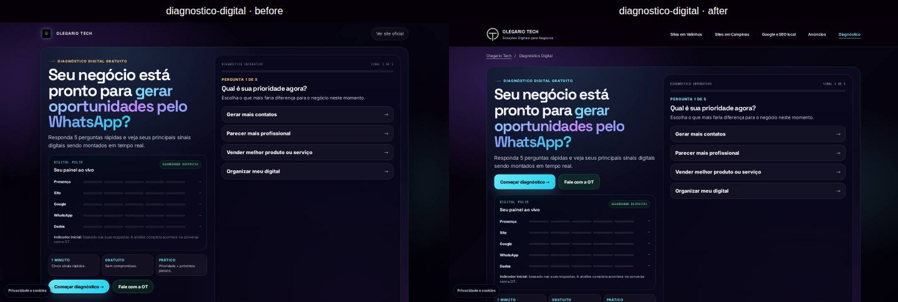

[Prévia Story](evidence/diagnostico-digital-story-preview.jpg) · [Fonte OG](kit/diagnostico-digital-og.svg) · [Fonte Story](kit/diagnostico-digital-story.svg)

## Correções após a primeira medição
- Aros decorativos contidos no próprio grid, corrigindo overflow em 1024 e 1366px.
- Botão de privacidade: prioridade de CSS corrigida para mostrar a engrenagem, sem texto cortado; nome acessível e painel preservados.
- Métricas de x-height e alinhamento do HERO estabilizados; Campinas desktop passou de CLS 0,12537 para **0,07814** no commit 7acb792. Todas as dez condições medidas ficaram abaixo de 0,1 nessa revisão. O teste agora bloqueia CLS acima de 0,1.
- A mesma revisão identificou um overflow residual do cabeçalho do Diagnóstico em 1024px. A candidata passa a abrir o menu compacto até 1100px; a matriz é repetida no último HEAD. Consulte o resultado final no PR, sem confundir o JSON histórico com o status atual.
- Evidência numérica histórica dessa revisão: [QA-7acb792.json](QA-7acb792.json).

## Referência visual atual da home (somente leitura)

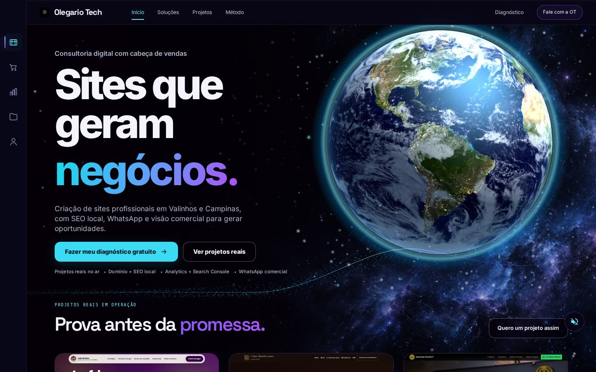
